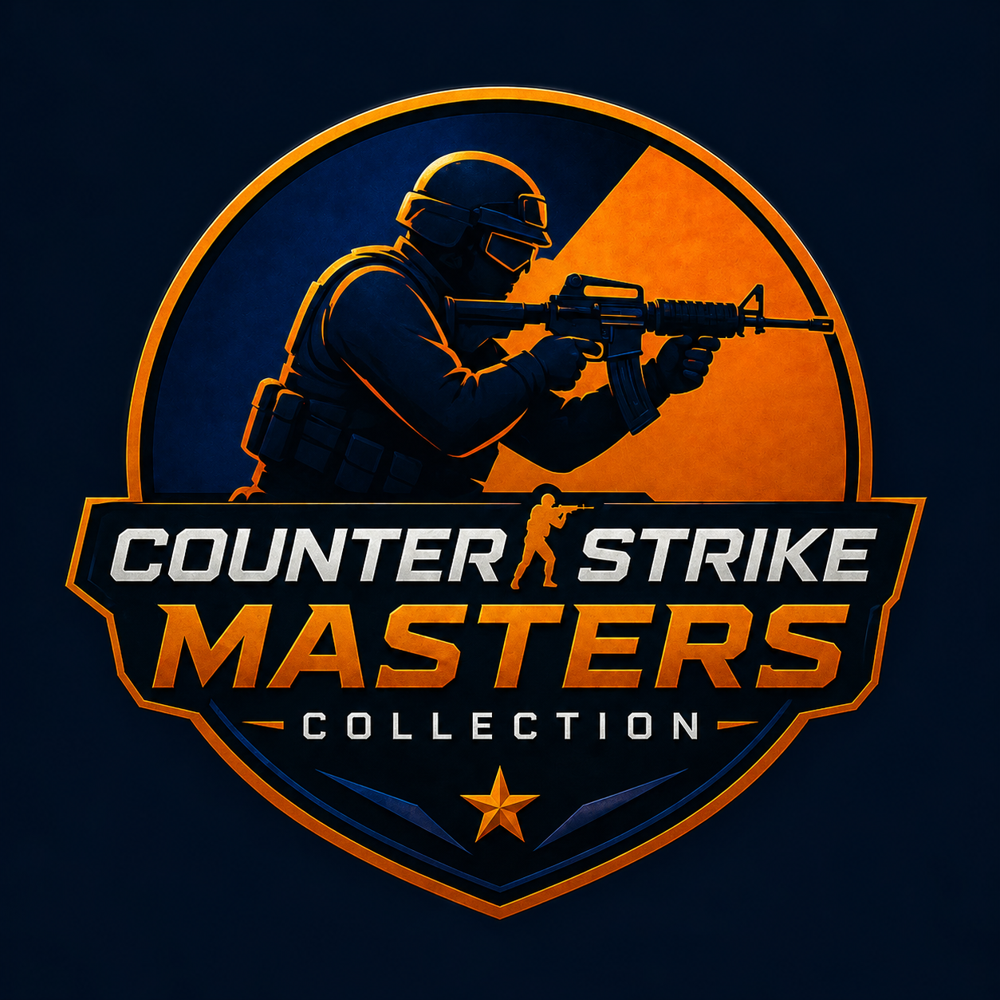
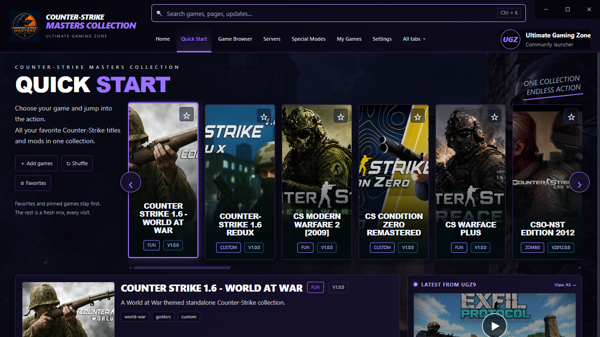

# Counter-Strike Masters Collection

<p align="center"></p>

A Windows launcher for a curated collection of Counter-Strike classics and community mods.

## Download CSMC

Current release: **v1.0.13**, November 8, 2026. Requires Windows 10 or 11, **64-bit**.

**[Download CSMC for Windows x64](https://github.com/AniketSpecter/Counter-Strike-Master-Collection/releases/download/v1.0.13/CSMC-Setup-1.0.13-x64.exe)** · [Release notes and checksums](https://github.com/AniketSpecter/Counter-Strike-Master-Collection/releases/tag/v1.0.13)

The installer is 141.38 MiB. Games download separately. The consumer launcher requires no account and installs per user by default. Existing users can also check for the update inside CSMC. Installation or restart requires your action.

This release provides an x64 installer. Older 32-bit builds remain in historical releases.

The installer is **not digitally signed**, so Windows may show a SmartScreen warning. Verify its origin and checksum before deciding to run it.

SHA-256 for `CSMC-Setup-1.0.13-x64.exe`:

```text
6e12e42e08f7385fab78f9fb64f99d946278f64728bd675192c2cebb1f5465b0
```

## Features

- Browse the live public game library and install titles on demand.
- Quick Start with favorites, pinned games, and a stable shelf during background updates.
- Search games and launcher pages; manage installed games and multiple library locations.
- Download progress, pause/resume, installation, repair, locate, move, and uninstall controls.
- Ten themes with saved preferences, server browsing, playtime, community videos, notifications, and Patch Notes.
- Automatic signed catalog synchronization, including removals and restores after reconnecting.

When an administrator removes a game, it disappears from launcher listings after the next successful sync. Offline launchers update when they reconnect. This preserves installed player files. The release bundles a 27-game listing; available games can change independently of app updates.

## Preview



## Help

[User guide](docs/USER-GUIDE.md) · [Report a bug](https://github.com/AniketSpecter/Counter-Strike-Master-Collection/issues/new/choose) · [Roadmap](ROADMAP.md) · [Discord](https://discord.gg/cGxs3jTf3e) · [UGZ9 on YouTube](https://www.youtube.com/@ugz9)

Reports should include the launcher version, Windows version, game name, steps to reproduce, and exact error. Remove credentials and personal information from logs or screenshots.

## About this repository

This public repository contains downloads, documentation, release notes, screenshots, and community support. Source code, backend administration, and Master installer builds are maintained privately. Game archives are not included in GitHub releases.

Counter-Strike, GoldSrc, Steam, and related game content and trademarks belong to Valve and their respective owners. This community project is not affiliated with or endorsed by Valve.
