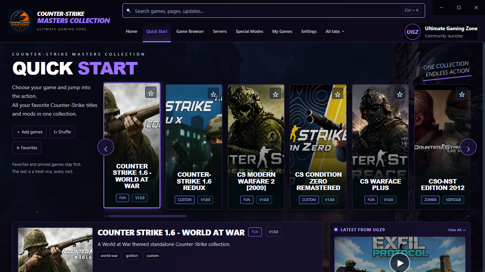

# CSMC user guide

Version 1.0.13 · Windows 10 / 11, 64-bit

## Install or update

1. Download [CSMC-Setup-1.0.13-x64.exe](https://github.com/AniketSpecter/Counter-Strike-Master-Collection/releases/download/v1.0.13/CSMC-Setup-1.0.13-x64.exe).
2. Verify the SHA-256 against the [release page](https://github.com/AniketSpecter/Counter-Strike-Master-Collection/releases/tag/v1.0.13). In PowerShell, run `Get-FileHash .\CSMC-Setup-1.0.13-x64.exe -Algorithm SHA256`.
3. Run the installer and follow its prompts. It installs into your user profile by default; you can choose a different location.
4. Open **CS Masters Collection** from the desktop or Start Menu.

The installer is unsigned and may trigger SmartScreen. Confirm the origin and checksum before deciding to run it. Updating the launcher preserves game files and settings; close the launcher when the installer asks.

## Find and play a game

**Quick Start** opens a shelf of games. Select a poster, star favorites, or use **Add games** to pin your choices. **Shuffle** changes the mix. Use **Install Game** for a missing game or **Play Now** for a ready installation.

**Game Browser** shows the public catalog. Search by name and use category filters. Global search also finds launcher pages. **My Games** shows installed titles that remain available in the launcher.

Use **Locate** to register an existing installation. The game menu offers launch executable selection, repair, move, open folder, and uninstall where supported. Uninstall deletes local game files; check the selected location before confirming.

## Downloads and storage

Choose an install location when prompted. The recommended game root is `%LOCALAPPDATA%\CSMC`. Settings lets you manage game libraries and the download cache.

**Downloads** displays progress, speed, transferred bytes, and download or installation errors. Pause and resume retain progress. A provider may limit or remove a file; report persistent errors with the game name and exact message. Third-party game downloads are separate from the launcher installer.

Games using an external setup program may require you to finish that setup and then use **Locate** to register the installed folder. Counter-Strike WW2 offers supported mode and graphics choices before launch.

## Live library changes

The launcher syncs the signed public catalog. Games removed by an administrator disappear from launcher listings after a successful sync, including installed-game listings. Their files stay on your disk. A restore makes the listing available again after syncing.

An offline launcher cannot receive a removal immediately. Reconnect to the internet and allow synchronization; restart CSMC if the listing remains stale. Updating to v1.0.13 includes reconnect refresh and protection against older catalog replies.

## Preferences and updates

Settings includes libraries, downloads, appearance, detection, runtimes, updates, and diagnostics. Choose one of ten themes; the choice applies immediately and persists after restart.

**Notifications** contains published announcements. **Patch Notes** contains release changes. Use the update controls to check for a new launcher version; when an update is ready, use Downloads to restart and install. Catalog changes do not require reinstalling the app.

**Servers** lists community servers when the feed is available. Community videos and external services require an internet connection.

## Troubleshooting

- **Missing game:** check the connection and allow catalog syncing. A removed title stays hidden until the administrator restores it.
- **Missing executable:** use Locate or the launch executable option and select the actual game executable.
- **Game fails to launch:** check Settings for missing runtime dependencies and consult that game's requirements.
- **Download failure:** record the game, error, source, free disk space, and install path. Pause/resume or retry after restoring connectivity.
- **Update failure:** download the current installer from the official release page and verify its checksum.

[Report a problem](https://github.com/AniketSpecter/Counter-Strike-Master-Collection/issues/new/choose). Include version, Windows details, reproduction steps, and screenshots with personal information removed.
